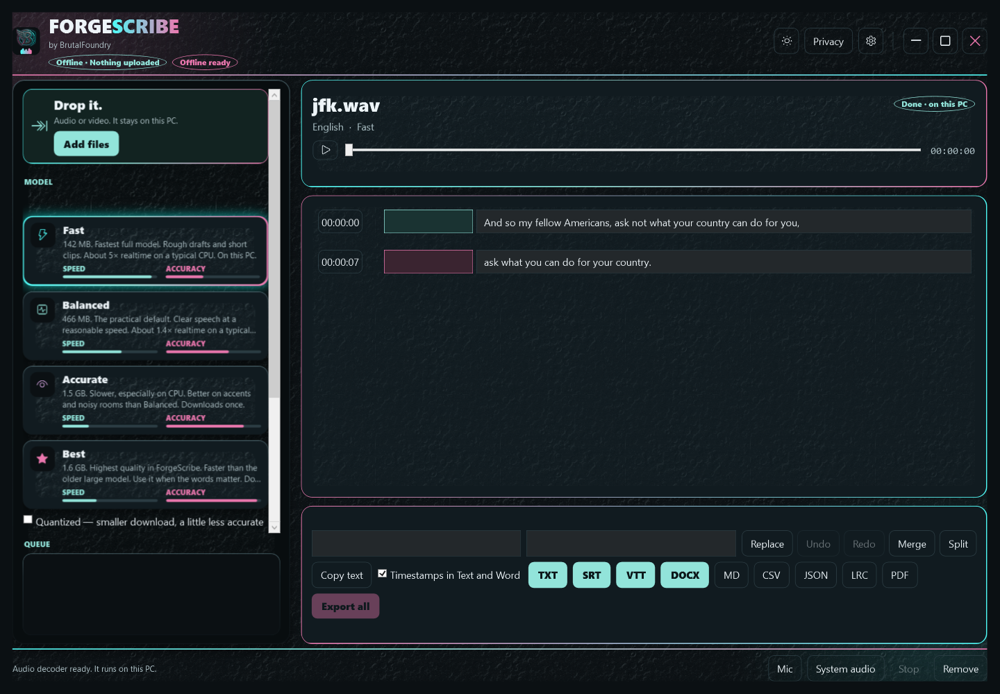
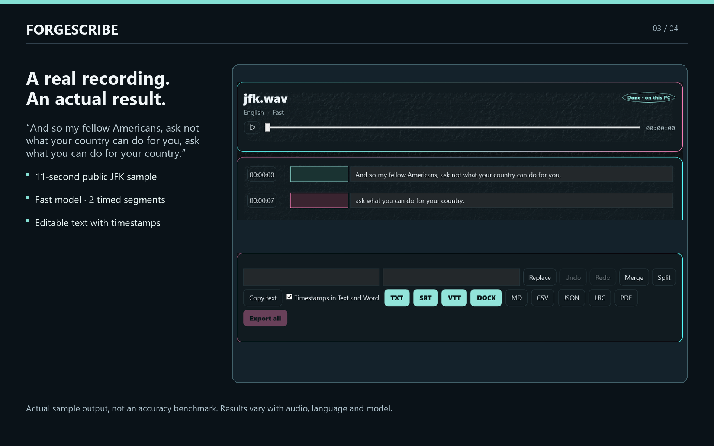
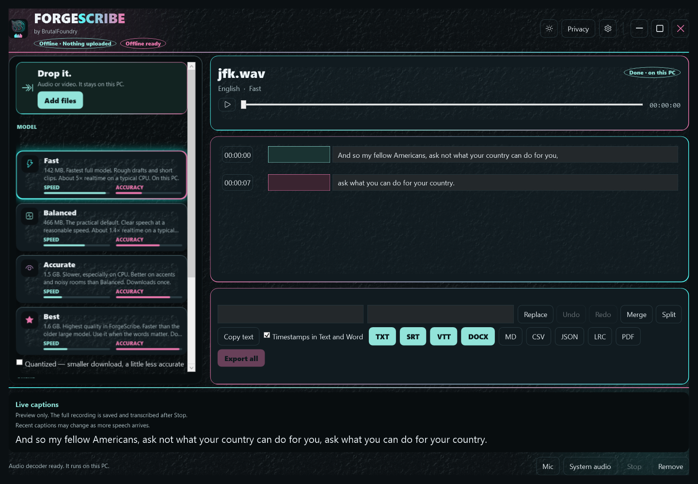

# ForgeScribe

### Turn recordings into text. Keep them on your PC.

ForgeScribe by **BrutalFoundry** turns interviews, lectures, voice notes and videos into editable text and subtitles with local speech recognition on Windows.

**[View in Microsoft Store](https://apps.microsoft.com/detail/9NJG5MVSJ582)** · **[Website and walkthrough](https://brutalfoundry.com/forgescribe)** · **[Privacy policy](https://brutalfoundry.com/forgescribe-privacy)**

US$14.99 once · Seven-day Store trial · No subscription · No ForgeScribe account

Now available in Microsoft Store. Microsoft displays local pricing and trial terms.

## What you can do

- **Transcribe locally.** The app does not upload your recordings, videos, transcripts or imported models.
- **Work with audio and video.** Add MP3, M4A, WAV, MP4, MKV or MOV files, individually or in a batch.
- **Record and follow along.** Select a microphone or system-audio output and preview live captions while recording. Preview words can change or lag; Stop queues full transcription.
- **Review the result.** Search and replace, undo and redo, merge or split text, and rename optional speaker labels.
- **Export your work.** TXT, SRT, VTT, DOCX, Markdown, CSV, JSON, LRC and PDF.
- **Choose your model.** Fast, Balanced, Accurate or Best, plus compatible whisper.cpp GGML .bin import. Supported Vulkan hardware can accelerate recognition; a CPU path is available.
- **Resume interrupted work.** Saved transcription checkpoints support recovery. Keep the original media; recovery is not guaranteed for every failure.

## How it works

1. **Add files or record.** Choose existing audio/video or capture a selected audio device.
2. **Choose a speech model.** Download each model you need once, then run speech recognition locally.
3. **Review and edit.** Check the words, timestamps and optional speaker labels.
4. **Export.** Save editable documents, plain text or timed subtitles for your workflow.

## A real result

The example uses the Fast model on an 11-second public English JFK recording and produces two timed segments. It is one sample, not a general accuracy or speed guarantee. The images show the actual application interface rendered for product review with real transcription output.

## Live caption previews

Recent words are revised as more context arrives. Preview latency depends on hardware, the model and other transcription work. The original recording is saved independently.

## Languages

Menus and settings: English, Español, Français, Deutsch, 简体中文, हिन्दी, العربية, বাংলা, Português (Brasil), Русский, Bahasa Indonesia and اردو.

Spoken-language selection is separate from menu language. Some technical messages, model descriptions and documentation remain English. Speech translation produces English text.

## Before installing

- Windows 10 version 22H2 or Windows 11, **x64**.
- Free disk space for models, recordings and temporary decoded audio.
- Internet for missing model downloads and when Microsoft Store licensing requires it.
- An active Store license to open the app. After a trial expires, purchase is required to open the app and its saved transcript history. Original recordings and exported files remain usable outside ForgeScribe.
- Recognition, translation and speaker labels can be wrong. Review important results, particularly noisy or overlapping speech. PDF has limited character coverage; use DOCX or TXT when unsupported text is reported.

## Press and reviewers

[Press kit (ZIP)](press/ForgeScribe-press-kit.zip) with the logo, three product images and factual product notes. [Read the product facts](press/facts.txt). The real-result image is one public speech sample, not a general performance benchmark.

## Support

[Version history](RELEASES.md)

Email **[support@brutalfoundry.com](mailto:support@brutalfoundry.com)** or open an issue here with your Windows version, selected model, steps and error message. Keep private recordings, account information and personal transcript contents out of public issues.

This repository contains product information and approved images. The application is distributed through Microsoft Store; its source is maintained separately.

© 2026 Brutal Foundry LLC. All rights reserved. Third-party content remains the property of its respective owners.
